# 🐠 ThermalAcuarium

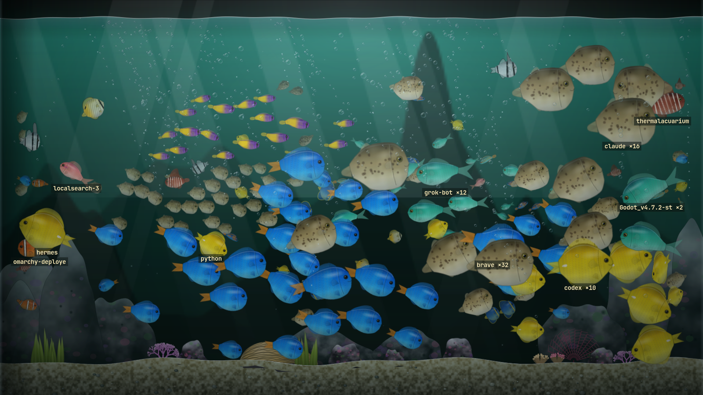

An aquarium that is your computer. Every real process is a fish, and the water is the machine.
Built with **Rust** (GTK4 + Libadwaita), themed from the active **Omarchy** theme.

| Hardware / process data | What you see |
| :--- | :--- |
| Process RAM | **Body size** (log scale: from a 1 MB plankton to a multi‑GB whale) |
| Process CPU | **Swim speed** and tail beat |
| Process disk writes | **Bubbles** from the fish's mouth |
| Same process name | A **shoal**: one species/colors per name, one fish per PID, swimming in a loose formation (a big shoal is a wide cloud, not a column) |
| CPU temperature | The water **boils**: bubbling from the sand, glow, foam, agitated fish |
| System RAM usage | Water gets **murky** when memory is nearly full |
| Load average | Strength of the **current** (marine snow) |
| Total disk writes | Air stone bubbling |
| Session processes (Hyprland, pipewire…) | **Decoration** (coral, anemones, rocks, seaweed) — never killable |

Fish are procedural (spine‑driven body, tail and fins), not flat sprites.

## Memory tab: the volcano

Arcade mode has tabs (`1`/`2`/`3`, or the tab bar): **Processes** is the aquarium, **Memory** is a
volcano drawn in cross‑section, like a textbook diagram. The left half is the outside; the right half
is cut open and shows the magma chamber, and **the magma level is exactly the RAM in use**, read
against a 0–100 % scale next to it. Cache & buffers are the crust of cooler magma on top, the free
memory is the snow cap on the outside (it melts as memory fills), the programs using the most RAM are
the lava flows running down the slope, and swap opens glowing fissures in the plain: one per program with memory in swap, labelled with its
name and size. Past ~90 % the crater erupts
(bombs, ash, ground shake) and the lava overflows the rim. `THERMALACUARIUM_DEMO_MEM=0.97` previews it.

| 55 % | 97 % |
| :--- | :--- |
| 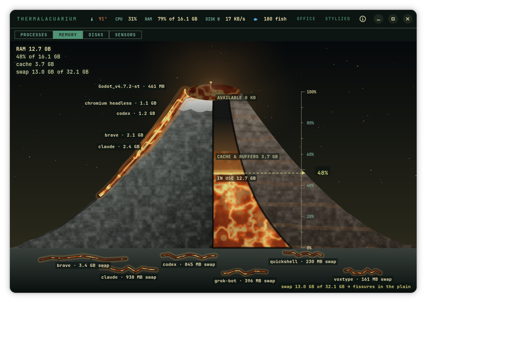 | 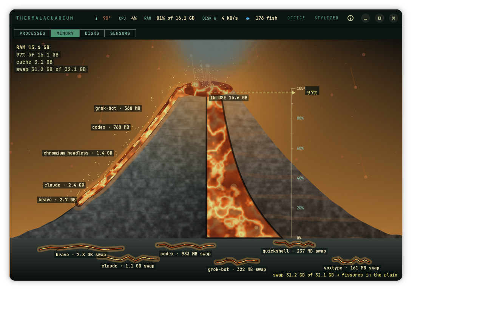 |

## Disks tab: rivers

**Disks** turns every physical disk into a river running down a valley. **The riverbed is the whole
disk**: the water runs down the middle as wide as the space used, and the dry gravel banks on both sides
are the free space (a low river in a wide bed), with a 0–100 % rule across the bed at the cliff edge. Disk activity
(read + write, log scale) is the speed of the current; the water then plunges over the cliff into a
reservoir whose level repeats the occupancy on the dam's gauge. The programs doing the most disk I/O
are the tributary streams that spring from the hillside and join the river (↓ read, ↑ write). Partitions and device‑mapper volumes (LUKS,
btrfs subvolumes) are folded into their physical disk.

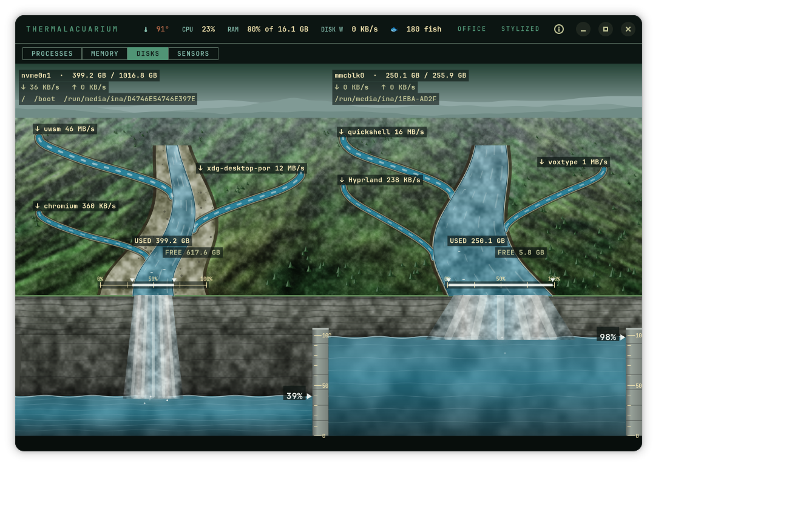

## Sensors tab: the weather

**Sensors** is the weather report. The CPU temperature is the weather itself: cool means a clear sky
and a soft sun; warm, haze; hot, a heat wave with the air shimmering and the grass scorched; critical,
a firestorm with lightning and falling embers. The fans are the wind (clouds race, trees and grass
bend), the load average is the cloud cover, and a thermometer on the right shows CPU, GPU and NVMe on
a 30–105 °C scale with the warm/hot/critical bands; the legend at the top left says which part of the
scene is which sensor, with the live value. `--temp 99` previews the storm.

| 55 °C | 99 °C |
| :--- | :--- |
| 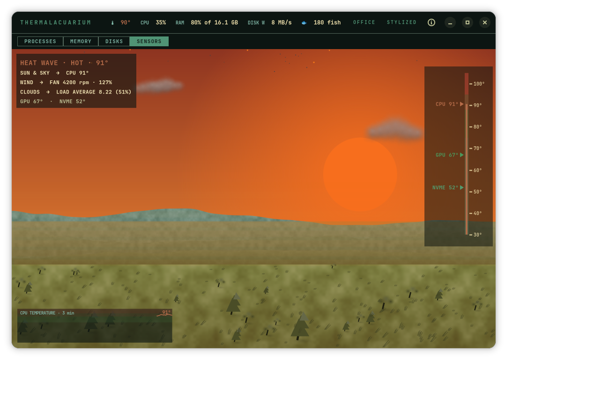 | 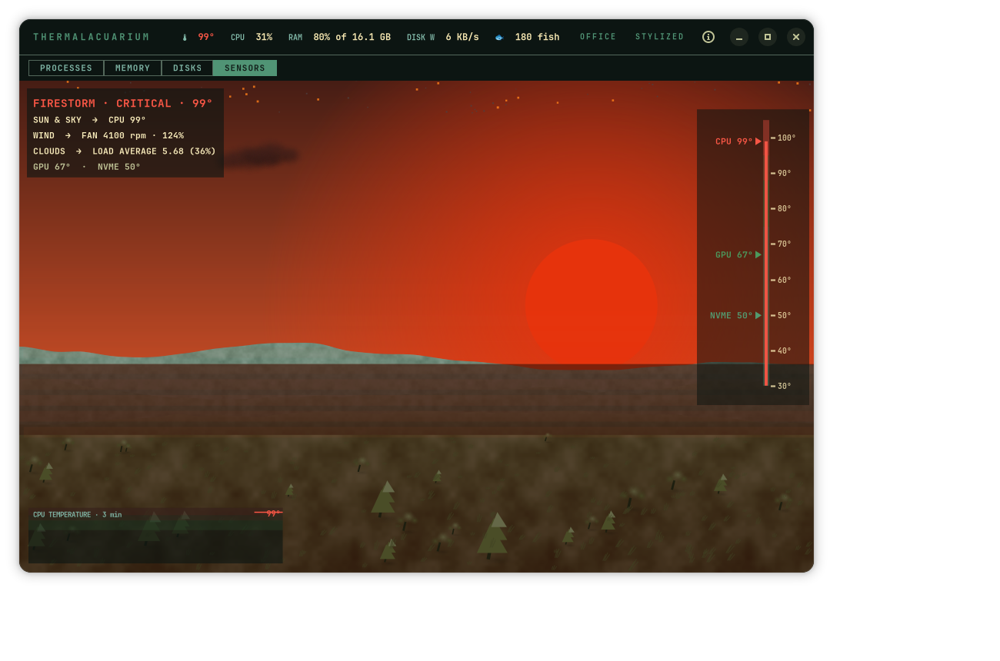 |

Office mode has matching **Memory**, **Disks** and **Sensors** tabs with the plain numbers.

## Office mode: a plain task manager

Press **`O`** (or the ARCADE/OFFICE button in the header) to swap the tank for a sober task manager in
the same Omarchy theme. The choice is remembered.

- **Processes**: one row per program (same grouping as the shoals): processes, PID, CPU, RAM with a
  bar, disk writes. Click a column header to sort, type to filter, CLOSE sends the same
  SIGTERM→SIGKILL as clicking a fish. Session processes (Hyprland, pipewire…) can't be closed here
  either.
- **Performance**: CPU, RAM, disk writes and CPU temperature with a two‑minute history each, plus load
  average, read throughput and GPU/NVMe temperatures.

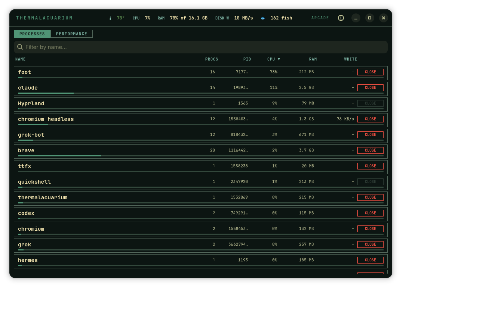

`thermalacuarium --office` starts there. Every tab has an arcade skin and an office view.

## Four visual styles

Press **`T`** (or click the style button in the header) to cycle; the choice is remembered
(`~/.config/thermalacuarium/style`, or start with `--style stylized|pixel|real|sonar`).

- **Stylized** (default): soft procedural fish painted with your Omarchy theme colors.
- **Pixel**: pixel art in the spirit of the Omarchy logo. Seven hand‑drawn species (tropical, tetra,
  angelfish, puffer, betta, torpedo, discus) with three tail frames, flat theme colors and a
  one‑pixel ink outline. A process's size is the sprite's integer zoom: a 1 MB process is a 1× fish,
  an 8 GB one is an 8× fish. Bubbles, light shafts and corals share one pixel grid.
- **Sonar**: the tank as a radar screen. Dark background with a grid, range rings and scanlines, a
  sweep arm that turns every ~11 s and lights up each fish as it passes (the echo then fades until
  the next pass), every fish a glowing trace (outline with halo, spine and ribs) in one hue of your
  theme per shoal, protected processes as dim infrastructure, bubbles as rings, the surface and the
  sand as bright traces. When the CPU boils the whole screen shifts to red, flickers and the sweep
  speeds up.
- **Realistic**: a reef aquarium. 15 species with real anatomy and coloring (clownfish, blue and
  yellow tang, royal gramma, chromis, butterflyfish, angelfish, mandarin dragonet, anthias, cardinalfish,
  damselfish, pufferfish, wrasse, lionfish, grouper) with countershading, scales, fin rays and
  eyes with iris; deep water with light shafts and **caustics** on sand and rock, blurred reef wall,
  live rock, pebbled sand, glass reflections, a mirror‑like water surface, distance fog, and corals,
  kelp, sea fans, brain coral and bubble‑tip anemones for the protected processes. Boiling water
  turns amber with glassy bubbles.

All four **read the active Omarchy theme** and follow theme changes live (run `omarchy theme set …`
and the window and the tank recolor within a second). In the realistic style the water, light shafts,
reef wall, rocks, sand tint, glass and air take their hue from the theme's blue/cyan, dark themes give a
night tank and light themes a bright daytime tank, and fish get a faint tint of that water; species keep
their natural colors (a clownfish is still orange). Preview other themes without changing yours with
`thermalacuarium --theme gruvbox`.

## Use

- **Hover** a fish: name, PID, RAM, CPU, disk writes. Its shoal lights up.
- **Click** a fish: confirm dialog → close that process (or the whole shoal). It sends `SIGTERM` and,
  if the process is still the same one after 3 s, `SIGKILL`. The fish floats belly‑up while it dies.
- `L` cycles name labels (big shoals / all / none) · `Space` pauses · `T` switches style · `O` toggles office mode · `1`–`5` pick a tab · the ⓘ button in the header opens *About* (with the link to the author's X, [@theinaog](https://x.com/theinaog)).
- Processes that start swim in from the sides; processes that exit dissolve into bubbles.

Only processes of your own user are shown. The tank holds the 180 biggest.

## Install / run

Nothing needs to be installed: the app is one file that only needs **GTK 4 and libadwaita**
(already part of Omarchy).

### Omarchy plugin (recommended)

```bash
omarchy plugin add https://github.com/IAnMove/ThermalAcuarium --enable
```

That is all. The bar widget shows the CPU temperature (🐠, or 🫧 when the water would be boiling).
The first time you click it, the plugin downloads the app (~1.1 MB, from this repo's releases, with its
sha256 checked) into its own folder and opens it; after that it starts instantly. Click opens the
aquarium, right‑click opens another window. `omarchy plugin update` keeps it current (the launcher
fetches the binary of the new version when `manifest.json` changes).

Move the widget with `omarchy bar move io.github.ianmove.thermalacuarium --section left|center|right`.

### Portable (no installation, no plugin)

```bash
curl -L -o thermalacuarium https://github.com/IAnMove/ThermalAcuarium/releases/latest/download/thermalacuarium-x86_64-linux
chmod +x thermalacuarium && ./thermalacuarium
```

or from a clone, with the same launcher the plugin uses (downloads the binary, or builds it with
`cargo` if it cannot; `THERMALACUARIUM_BUILD=1` forces building from source):

```bash
git clone https://github.com/IAnMove/ThermalAcuarium && ./ThermalAcuarium/thermalacuarium.sh
```

It writes nothing outside `~/.config/thermalacuarium/style` (only if you switch style).

### Installed (PATH + app menu entry)

```bash
./install.sh            # builds, installs ~/.local/bin/thermalacuarium and a desktop entry
./install.sh --plugin   # ...and also adds the Omarchy bar widget
```

It is a normal (tiled) window; no Hyprland rules needed.

## Options

```text
thermalacuarium --temp 95          # force the water temperature to preview the boil
THERMALACUARIUM_LANG=es thermalacuarium
thermalacuarium --snapshot out.png [--style real] [--size 1180x680] [--seconds 8] [--temp 99] [--demo] [--dying 3] [--names 1] [--hover 600,300] [--bench]
thermalacuarium --snapshot gallery.png --gallery --style real --len 210   # all reef species
thermalacuarium --snapshot gallery.png --gallery --style pixel --len 300  # all pixel species
thermalacuarium --bench-scene volcano|rivers|weather                       # ms per frame of a tab, no window
GDK_BACKEND=broadway BROADWAY_DISPLAY=:5 thermalacuarium --bench-gpu --style real   # UI-thread cost per frame of the tank (needs a gtk4-broadwayd :5)
TA_PROF=1 thermalacuarium                                                  # print per-section frame times to stderr
thermalacuarium --office           # start in the task-manager view
thermalacuarium --theme nord       # preview another Omarchy theme (or THERMALACUARIUM_THEME=nord)
thermalacuarium --new-instance     # open another window without activating the running one
```

`--snapshot` renders the tank to a PNG with Cairo (no window), handy for tweaking the look.

## How it stays light

Animation is capped at ~30 FPS and stops when the window is hidden or the tab is not the visible one.
Each fish variant is painted once with Cairo into a sprite **on a worker thread**; until it arrives the
nearest existing sprite of that shoal is shown, so the UI thread never waits for a rasterization. GTK
composes the sprites on the GPU (transforms, gradients and bubbles are GSK nodes): building a frame of
180 fish costs about 1 ms of UI-thread time (stylized, sonar, realistic; Pixel a little more). When the
sprite cache passes 160 MB, sprites unused for 20 s are evicted. Switching to the realistic style or
resizing it bakes its background layers once (about 100 ms, a single hitch).
The decoration sways through 16 cached poses, `/proc` is sampled on its own thread, and the volcano,
rivers and weather scenes bake everything static (terrain, sky, lava halos, tributaries, grass) and
redraw only what moves (about 2–5 ms per frame each, at 30 FPS).

## Credits

Telemetry code (`/proc`, `/sys/class/hwmon`) and theming come from ThermalWatch.

## Screenshots

| Stylized | Pixel | Sonar |
| :--- | :--- | :--- |
| 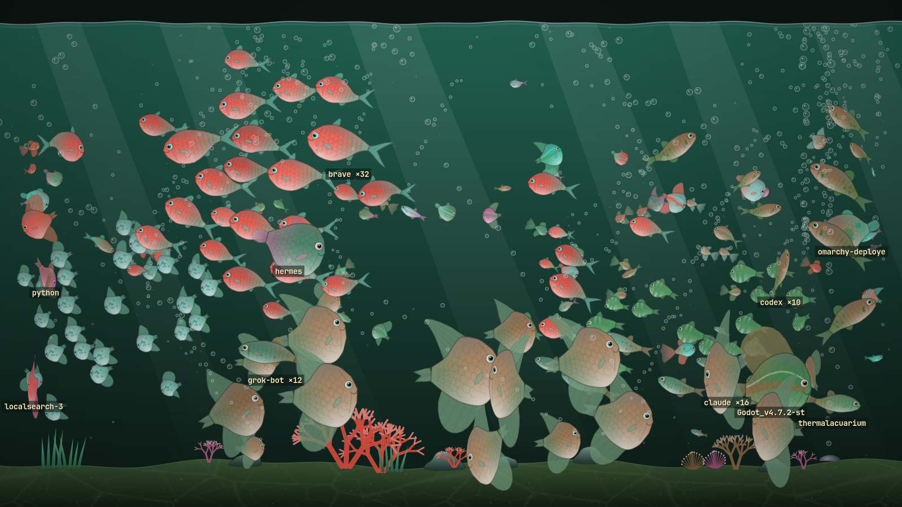 | 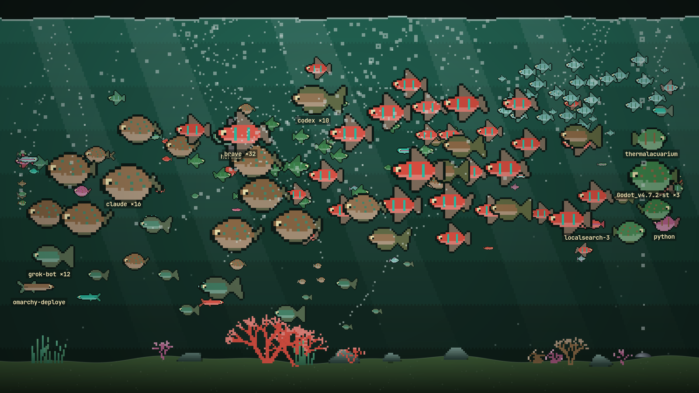 | 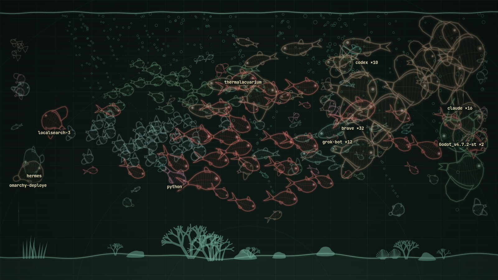 |

| Boiling water (realistic) | Reef species |
| :--- | :--- |
| 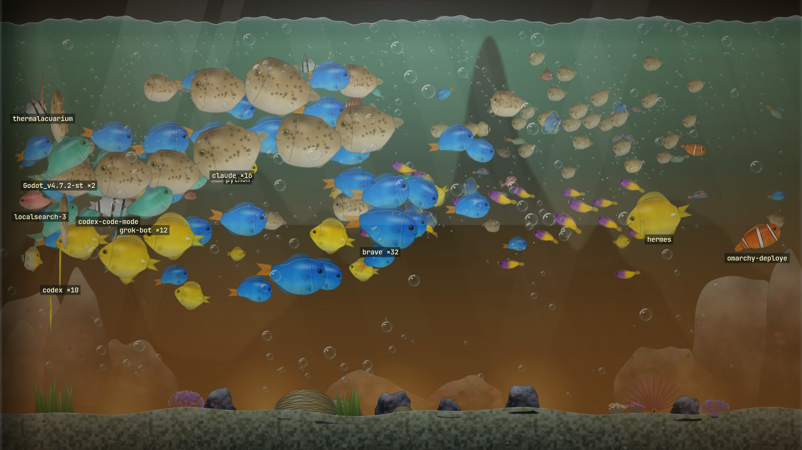 | 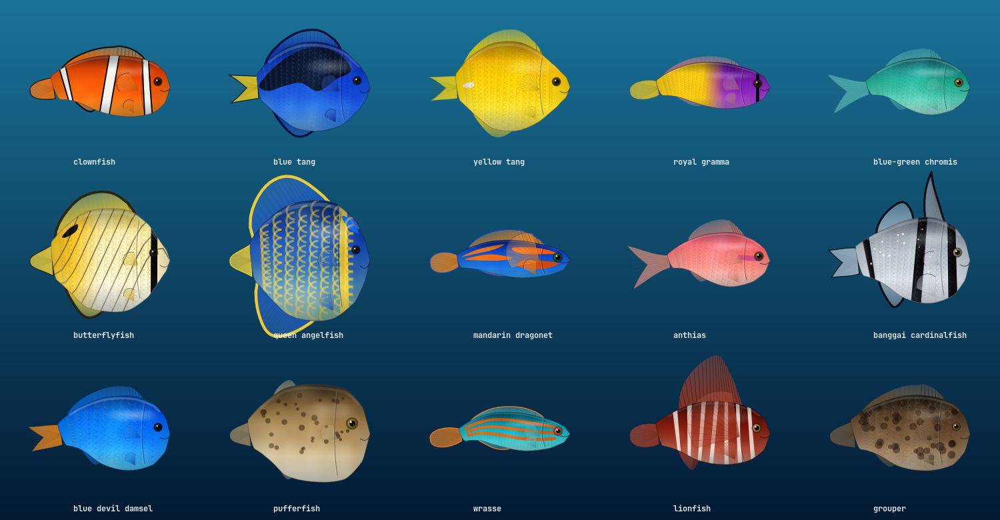 |

(Rendered with `--snapshot --demo`.)
